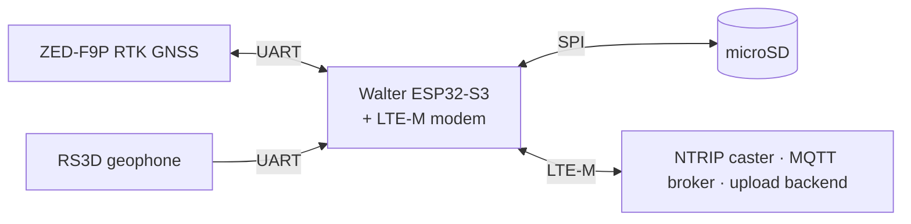

# Open Permafrost Monitor

An unattended, battery-powered field station that measures **ground
movement** (u-blox ZED-F9P RTK GNSS) and **ground vibration** (Raspberry
Shake RS3D geophone, 3 × 200 sps MiniSEED). It runs on a Walter ESP32-S3
with an on-board LTE-M/NB-IoT modem, with no WiFi or router. It sends
position telemetry over MQTT after every measurement, uploads a daily
positions file, and keeps all raw data on the SD card.

📖 **Documentation: <https://louispauchet.github.io/open-permafrost-monitor/>**
(source in [`docs/`](docs/index.md))



| I want to… | Read |
|---|---|
| Build and flash a station | [Build a station](docs/build/index.md): [wiring](docs/build/wiring.md), [flashing](docs/build/flashing.md) |
| Configure, deploy, collect data | [Field use](docs/field/index.md): [menu](docs/field/configuration.md), [commissioning](docs/field/commissioning.md) |
| Use the data | [Data](docs/data/index.md): [MiniSEED](docs/data/miniseed.md), [positions CSV](docs/data/positions-csv.md), [MQTT](docs/data/mqtt.md) |
| Understand the firmware | [How it works](docs/how-it-works/index.md) |
| Change the code | [Develop](docs/develop/index.md) |

## Quick start

```sh
git clone https://github.com/LouisPauchet/open-permafrost-monitor.git
cd open-permafrost-monitor
cp include/secrets.h.example include/secrets.h   # NTRIP / MQTT / upload seeds
pio run -e walter -t upload
pio device monitor -e walter
```

Then follow [First boot](docs/build/first-boot.md).

## Licence

[EUPL v1.2](LICENCE). Developed at SINTEF within the ARCHAIC project.
