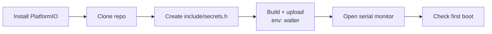

# Flash the firmware

The firmware is built with [PlatformIO](https://platformio.org/). It
downloads the right compiler, ESP32 core and libraries by itself. The ESP32
platform is pinned to **espressif32 6.13.0** (Arduino core 2.0.17). Newer
platforms do not build the vendored modem library, so don't upgrade it.



## 1. Install the tools

=== "VS Code (recommended for beginners)"

    1. Install [Visual Studio Code](https://code.visualstudio.com/) and [Git](https://git-scm.com/).
    2. In VS Code, open **Extensions** and install **PlatformIO IDE**.
    3. Restart VS Code. A PlatformIO (ant) icon appears in the left bar.

=== "Command line"

    ```sh
    python -m pip install --upgrade platformio
    pio --version
    ```

The first build downloads about 1 GB of toolchain. This happens once.

## 2. Get the code

```sh
git clone https://github.com/LouisPauchet/open-permafrost-monitor.git
cd open-permafrost-monitor
```

In VS Code: **File → Open Folder…** and choose `open-permafrost-monitor`.
PlatformIO finds `platformio.ini` automatically.

## 3. Create `include/secrets.h`

```sh
cp include/secrets.h.example include/secrets.h
```

Edit `include/secrets.h` and fill in what you have:

| Setting | Meaning |
|---|---|
| `NTRIP_HOST`, `NTRIP_PORT`, `NTRIP_MOUNTPOINT`, `NTRIP_USER`, `NTRIP_PASSWORD` | Your RTK correction service |
| `MQTT_HOST`, `MQTT_PORT` (8883 = TLS), `MQTT_CLIENT_ID`, `MQTT_USER`, `MQTT_PASSWORD`, `MQTT_TOPIC` | Telemetry broker. For ThingsBoard, put the device token in `MQTT_USER` and leave the password empty. |
| `UPLOAD_HOST`, `UPLOAD_PORT`, `UPLOAD_API_KEY` | Your [upload backend](../data/upload-api.md). Leave `UPLOAD_HOST` empty (`""`) to disable the daily upload. |

!!! info "These are only first-boot defaults"
    `secrets.h` is copied into the board's flash (NVS) **on the first boot
    only**. After that, the values in flash win, and you change them from the
    [service menu](../field/configuration.md) without reflashing. Reflashing
    with a new `secrets.h` does **not** overwrite settings already in flash.
    See [Configuration model](../how-it-works/configuration-model.md).

    `secrets.h` is git-ignored. Never commit it.

Measurement intervals, thresholds and SEED codes are **not** in
`secrets.h`. They have built-in defaults and are set from the service menu.

## 4. Build and upload

Connect the Walter board over USB-C.

=== "VS Code"

    In the PlatformIO sidebar, expand **walter → General**:

    1. **Build:** compiles. Check for `SUCCESS`.
    2. **Upload:** compiles and flashes.
    3. **Monitor:** opens the serial console (115200 baud).

    !!! warning "Pick the `walter` environment"
        The project also has a `native` environment, used for unit tests on
        the PC. The status-bar Upload button works on the *default*
        environments. If it tries to build `native` too, use the sidebar
        tasks under **walter** instead.

=== "Command line"

    ```sh
    pio run -e walter                 # build only
    pio run -e walter -t upload       # build + flash
    pio device monitor -e walter      # serial console, 115200 baud
    ```

    Always pass `-e walter`. A bare `pio run` also builds the `native`
    test environment.

A successful upload ends with `Hard resetting via RTS pin...` and
`SUCCESS`.

### If the upload can't find the board

The console runs over the ESP32's native USB. If the firmware has crashed,
or the port isn't detected, put the chip in **download mode** by hand:

1. Hold the board's **BOOT** button (GPIO 0).
2. Press and release **RESET**.
3. Release **BOOT**.
4. Run the upload again. The COM/tty port may have a different name in
   download mode.
5. Press **RESET** after flashing to start the new firmware.

On Windows, check **Device Manager → Ports (COM & LPT)** to see which COM
port appears when you plug the board in.

## 5. Open the console

Open the monitor right after flashing, then go to [First boot](first-boot.md).

!!! note "Missed first lines"
    The console can miss the first few lines printed right after you
    connect. This is harmless. Press RESET, or reconnect the monitor, to see
    the boot sequence again.

## Building without hardware (container)

To check that the code compiles on a machine without PlatformIO, use
Podman or Docker with a throwaway Python container. Run this from the repo
root:

```sh
podman run --rm -v "$PWD:/src:ro" -v pio-cache:/root/.platformio python:3.11-slim \
  bash -c 'pip install -q platformio &&
           mkdir /work && tar -C /src --exclude=.pio --exclude=cao -cf - . | tar -C /work -xf - &&
           cd /work && cp include/secrets.h.example include/secrets.h &&
           pio run -e walter'
```

The `pio-cache` volume keeps the toolchain between runs. To also run the
unit tests, see [Build and test](../develop/building-and-testing.md).
