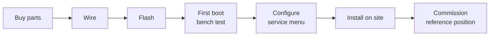

# Build a station

This section takes you from a pile of parts to a station that boots, logs
data and gets a GNSS fix. You don't need prior embedded-firmware
experience. Work through the pages in order:

1. **[Hardware](hardware.md):** what to buy.
2. **[Wiring](wiring.md):** what connects to which pin.
3. **[Enclosure parts](enclosure.md):** the 3D-printed mounts.
4. **[Flash the firmware](flashing.md):** install the tools, set credentials, upload.
5. **[First boot](first-boot.md):** what the console should show, and what to check.

When the station boots cleanly, go to [Field use](../field/index.md) to
configure it and deploy it.

