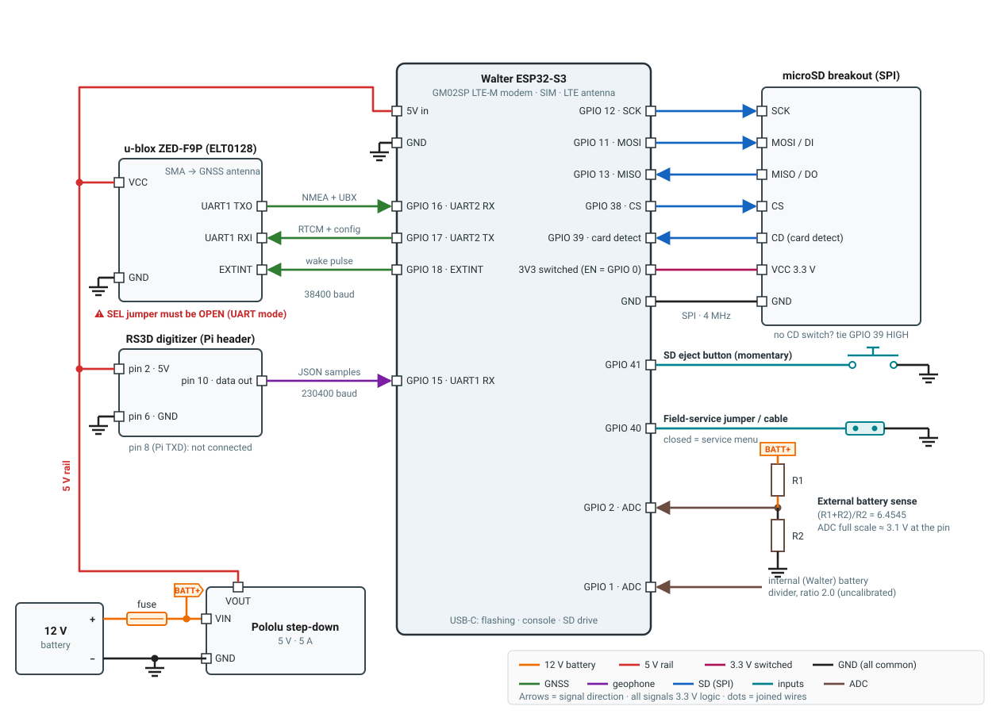

# Wiring

All pin numbers are **ESP32-S3 GPIO numbers**. They come from
[`include/pins.h`](https://github.com/LouisPauchet/open-permafrost-monitor/blob/main/include/pins.h),
the single source of truth. To move a signal to another pin, change it there
and nowhere else.

!!! danger "3.3 V logic only"
    Every signal connection is 3.3 V logic. None of these modules have
    5 V-tolerant signal pins, even the ones powered from 5 V.

## Wiring diagram

[{ width="100%" }](../assets/wiring.svg)

*Click the diagram to open it full size.* Each wire is coloured by
function, and arrows show which way signals flow. Every **GND** symbol is
the same common ground: connect them all together.

## Power

```text
12 V battery (+) ──[ fuse ]──┬── Pololu step-down VIN
                             └── BATT+ → R1/R2 divider → GPIO 2
12 V battery (−) ────────────── Pololu GND ── common GND
Pololu VOUT 5 V ─── 5 V rail ──┬── Walter 5V in
                               ├── ZED-F9P VCC
                               └── RS3D pin 2 (5V)
```

| Item | Notes |
|---|---|
| **Fuse** | Inline, on the battery **+** lead, as close to the battery as possible. It protects the wiring if anything downstream shorts. Size it for your wire gauge and the regulator's input current. |
| **Pololu 5 V, 5 A step-down regulator** | Feeds the **5 V rail** for the Walter board, the ZED-F9P and the RS3D. Check that its input range covers your battery's full voltage swing, including charging voltage if a solar controller is used. |
| **Battery sense** | The divider (R1/R2) is taken **after the fuse** (net `BATT+`), so the fuse also protects it. |
| **3.3 V for the SD card** | Comes from the Walter board's switched 3.3 V output (enable = GPIO 0, active LOW), not from the 5 V rail. |

## Pin table

| Subsystem | ESP32-S3 pins |
|---|---|
| GNSS (UART2, 38400 baud) | RX 16, TX 17, EXTINT 18 |
| Geophone (UART1, 230400 baud, receive-only) | RX 15 |
| SD card (SPI, 4 MHz) | SCK 12, MOSI 11, MISO 13, CS 38, card-detect 39 |
| SD power enable | 0 (active LOW, held enabled) |
| SD eject button | 41 (momentary to GND, internal pull-up) |
| Field-service select | 40 (grounded = service mode, internal pull-up) |
| Battery ADC | external 2, internal 1 |
| Console | native USB (CDC); UART0 (IO43/44) is unused |

## GNSS (ZED-F9P)

| Walter (ESP32-S3) | ZED-F9P breakout |
|---|---|
| GPIO 16 (RX) | UART1 **TXO** (F9P → ESP32) |
| GPIO 17 (TX) | UART1 **RXI** (ESP32 → F9P) |
| GPIO 18 | EXTINT |
| 5 V | VCC |
| GND | GND |

!!! warning "Open the SEL jumper first"
    The breakout's `SEL` jumper must be **unsoldered/open** to select UART1.
    If it is closed, the module may come up in I2C mode and nothing will
    show on the UART. The first-boot smoke test then reports
    `0 chars seen`.

The baud rate (38400) is set by the firmware. You don't configure anything
on the module. EXTINT is how the firmware wakes the F9P from its low-power
backup mode between bursts; see [Power management](../how-it-works/power.md).

!!! tip "TX and RX cross over"
    The F9P's **TXO** goes to the ESP32's **RX** (GPIO 16). Swapped TX/RX is
    the most common wiring mistake.

## Geophone (RS3D digitizer)

The digitizer board uses the Raspberry Pi 40-pin header layout, even
though there is no Pi. You need three connections:

| Walter (ESP32-S3) | RS3D digitizer (Pi header pin) |
|---|---|
| GPIO 15 (RX) | Pin 10 (Pi RXD: the sensor data stream) |
| 5 V | Pin 2 or 4 |
| GND | Pin 6, 9, 14, 20 or 25 |

The link is receive-only. Nothing goes to pin 8 (Pi TXD). The baud rate is
fixed at **230400** by the digitizer's own firmware. Full header pinout:
[Raspberry Shake protocol](../how-it-works/raspberry-shake.md#gpio-header-pinout-from-the-official-spec-sheet).

## SD card (SPI mode)

| Walter (ESP32-S3) | SD breakout |
|---|---|
| GPIO 12 | SCK |
| GPIO 11 | MOSI (DI) |
| GPIO 13 | MISO (DO) |
| GPIO 38 | CS |
| GPIO 39 | Card-detect switch |
| Switched 3.3 V output (enabled by GPIO 0, active LOW) | VCC |
| GND | GND |

**Card-detect:** if your breakout has no card-detect switch, tie GPIO 39
**HIGH**. The firmware treats HIGH as "card present". Otherwise it decides
the card is always missing.

!!! danger "GPIO 0 is a boot-strapping pin"
    Pulling GPIO 0 low **during reset** puts the ESP32 into its USB
    download (bootloader) mode instead of starting the firmware. The
    firmware only drives it low after boot, which is safe. If you build
    your own SD power switch (a MOSFET or load switch), make sure nothing in
    it can pull GPIO 0 low during power-up or reset.

**Why SPI and not SDMMC:** native SDMMC kept hitting command timeouts on
the reference board's provisional wiring. SPI's looser timing tolerates it
reliably, and the station only needs a few kB/s.

## Buttons

| Function | Connection | Behaviour |
|---|---|---|
| **SD eject** | Momentary button between GPIO 41 and GND | Press: flushes and closes every file, unmounts, cuts card power. Swap the card; reinserting it remounts (the station reboots). |
| **Field service** | Jumper, switch or cable wire between GPIO 40 and GND | Grounded: the station reboots into the [configuration menu](../field/configuration.md). Released: it reboots back into normal operation **without saving**. |

Neither needs an external resistor. Both use internal pull-ups.

## Battery monitoring

| Walter (ESP32-S3) | Signal | Divider ratio in firmware |
|---|---|---|
| GPIO 2 | External (12 V) battery, through a resistor divider | `EXTERNAL_DIVIDER_RATIO = 6.4545` (calibrated) |
| GPIO 1 | Internal (Walter) battery, through a resistor divider | `INTERNAL_DIVIDER_RATIO = 2.0` (**uncalibrated placeholder**) |

Battery voltage is the voltage at the pin times the ratio, averaged over 16
ADC reads. The ratios are in
[`src/battery.cpp`](https://github.com/LouisPauchet/open-permafrost-monitor/blob/main/src/battery.cpp).

!!! warning "Calibrate before trusting the low-battery cutoff"
    If your divider differs from the reference board's:

    1. Measure the battery with a multimeter.
    2. In the service menu, compare it with `Low-battery cutoff: ... (currently reading X V)` under option `1`.
    3. Scale the ratio by measured ÷ reported, then reflash.

    The external reading drives the [low-battery cutoff](../how-it-works/power.md#low-battery-backoff).
    The internal one is only reported in telemetry.
