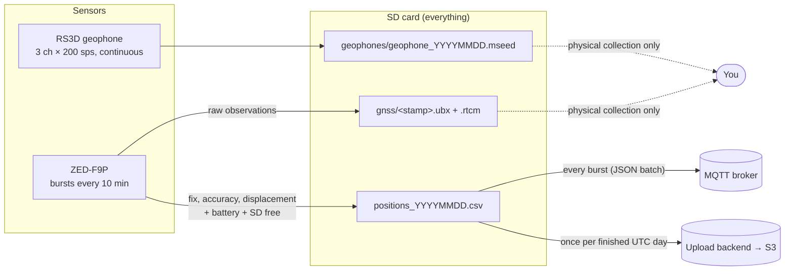

# Data

The station produces four data products. Each one has its own path off the
station.

| Product | Where | Latency | Page |
|---|---|---|---|
| Positions: fix, accuracy, displacement, battery, SD free | SD + MQTT + daily upload | About 10 min (MQTT) | [Positions CSV](positions-csv.md), [MQTT](mqtt.md) |
| Daily positions file | Your backend | About 1 day | [Upload backend API](upload-api.md) |
| Seismic waveforms | SD only | Until the next visit | [MiniSEED](miniseed.md) |
| Raw GNSS observations + corrections | SD only | Until the next visit | [GNSS raw / PPK](gnss-raw.md) |

All times are **UTC**, derived from GNSS. See [Timing](../how-it-works/timing.md)
for how accurate they are.
