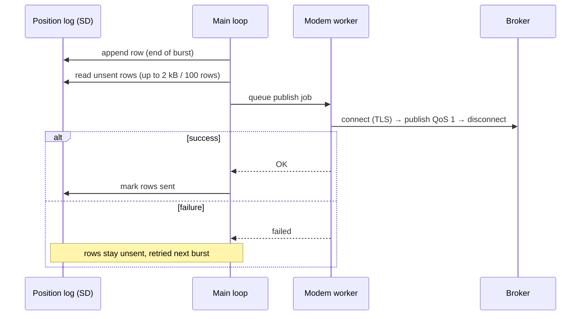

# MQTT telemetry

After every burst that uses the modem, the station publishes all position
rows **not yet sent** as one message. That is every burst when option `E`
is 1, the default.

| Property | Value |
|---|---|
| Transport | MQTT over TLS. The default port is 8883. |
| Trusted CA | **ISRG Root X1 only** (Let's Encrypt). The broker certificate must chain to it. |
| Auth | ThingsBoard style: username = device token, password may be empty. With an empty username, no credentials are sent. |
| Client ID | Configured value. If empty: `walter-<MAC>`. |
| Topic | Configured; default `permafrost/gnss/position`. For ThingsBoard use `v1/devices/me/telemetry`. |
| QoS | 1 |
| Max message | 2 kB. Rows that don't fit go out in the next batch. |

## Payload

A JSON **array** with one `{"ts", "values"}` object per row. This is the
ThingsBoard timestamped-telemetry shape. `ts` is the reading time (epoch
ms), not the arrival time, so delayed batches still plot at the correct
time.

```json
[
  {
    "ts": 1793096261000,
    "values": {
      "latitude": 78.2232012,
      "longitude": 15.6512034,
      "altitude": 12.34,
      "horizontal_accuracy": 0.014,
      "vertical_accuracy": 0.022,
      "fix_quality": 4,
      "quality_ok": true,
      "battery_external_v": 12.61,
      "battery_internal_v": 4.11,
      "has_displacement": true,
      "north_m": 0.012,
      "east_m": -0.004,
      "up_m": -0.031,
      "horizontal_displacement_m": 0.0126,
      "sd_free_mb": 27310
    }
  }
]
```

The fields are the same as the [positions CSV](positions-csv.md#columns),
with these differences:

- **No-fix rows** (`fix_quality` 0) **omit** `latitude`, `longitude`,
  `altitude` and both accuracies. They still carry the battery and
  `sd_free_mb`, so a blind station stays visible.
- `horizontal_displacement_m` = √(north² + east²) is added. It is 0 when
  `has_displacement` is false.
- `sd_free_mb` is omitted when unknown.

## Delivery semantics



- Delivery is **at least once**. The "sent" pointer is kept in RAM only,
  so after a reboot the current day's rows are published again.
  ThingsBoard de-duplicates them by `ts`; other consumers should do the
  same.
- Only rows from the **current UTC day's** file are batched. Rows that
  were never sent from an earlier day reach your backend through the
  [daily upload](upload-api.md), not MQTT.
