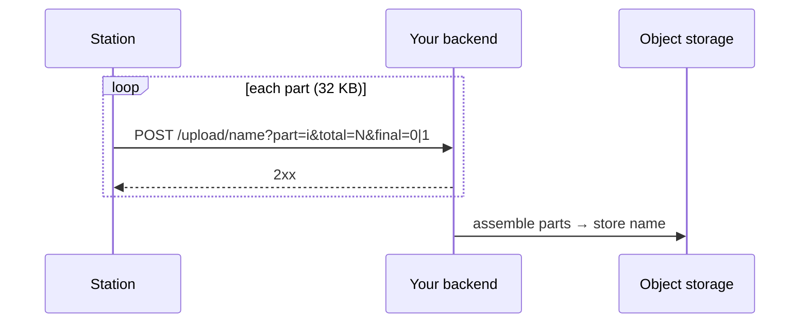

# Upload backend API

Once a UTC day is over, the station uploads that day's **positions CSV**
to an HTTPS endpoint **you run**. Your backend then stores it, for example
in S3-compatible storage. The station never holds cloud-storage
credentials, only a single API key that you can rotate. No backend
implementation ships with this repository; this page is the contract one
must meet.

MiniSEED and GNSS raw files are **not** uploaded. They are far too large for
LTE-M airtime and battery.

## Request

```http
POST /upload/positions_20261027.csv?part=0&total=3&final=0 HTTP/1.1
Host: upload.example.com
Authorization: Basic <base64("<API key>:")>

<up to 32768 bytes of the file>
```

| Element | Value |
|---|---|
| Scheme | HTTPS, TLS 1.2. The server certificate must chain to **ISRG Root X1** (Let's Encrypt). |
| Port | Configured (default 443) |
| Path | `/upload/<name>`, with `<name>` = `positions_YYYYMMDD.csv` |
| `part` | Chunk index, starting at 0 |
| `total` | Number of chunks for this file |
| `final` | `1` on the last chunk, otherwise `0` |
| Auth | HTTP **Basic**: username = API key, password empty |
| Body | Raw bytes of the chunk: 32 KB each, the last one shorter. An empty file is sent as a single empty part with `final=1`. |
| Content-Type | Set by the modem firmware, not by this project. Read the body as raw bytes whatever it says. |

A typical day's CSV (about 144 rows) is well under 32 KB, so it usually
arrives as **one request**: `part=0&total=1&final=1`.

## Behaviour the backend must handle



- **Reassemble by name and part.** Parts arrive in order, one at a time.
- **Idempotent.** A failed day is re-sent in full on the next burst. The
  same file can also arrive again after a reboot. Overwrite; don't append.
- **Any HTTP response counts as delivered.** The firmware checks only that
  the request completed, not the status code. Return `2xx` and handle
  errors on your side, by logging and alerting.
- **One day per burst.** Uploads happen at the end of a burst that has the
  modem up, so roughly every 10 min while catching up. The next day to
  send is kept in flash and advances only after success. After an outage,
  the station catches up at most **14 days** back.
- An empty `upload_host` (menu `7`) disables uploads.

## Minimal example (for illustration)

A sketch in Python/Flask. It is not part of this repository and not
hardened for production.

```python
import os, hmac
from flask import Flask, request, abort

app = Flask(__name__)
API_KEY = os.environ["UPLOAD_API_KEY"]
STORE = "/srv/uploads"
parts = {}

@app.post("/upload/<name>")
def upload(name):
    auth = request.authorization
    if not auth or not hmac.compare_digest(auth.username or "", API_KEY):
        abort(401)
    if "/" in name or not name.endswith(".csv"):
        abort(400)
    part = int(request.args["part"]); total = int(request.args["total"])
    buf = parts.setdefault(name, {})
    buf[part] = request.get_data()
    if request.args.get("final") == "1" and len(buf) == total:
        with open(os.path.join(STORE, name), "wb") as f:   # overwrite = idempotent
            for i in range(total):
                f.write(buf[i])
        del parts[name]
        # forward to S3 here (boto3.upload_file ...)
    return "", 204
```

Put it behind a reverse proxy with a Let's Encrypt certificate, such as
Caddy or nginx with certbot.
