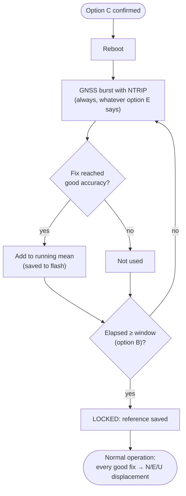

# Commissioning the reference position

The station's real measurement is **how far the ground has moved**, not
its absolute position. Commissioning sets the fixed benchmark it measures
from. The station averages good GNSS fixes over a window (default **2 h**)
and locks the result. From then on, every good fix is reported as a
**North / East / Up displacement** in metres from that benchmark.

!!! danger "Do this last, once the antenna is in its final position"
    Commission only after the antenna is permanently mounted. If the
    antenna moves afterwards, the displacement shows that movement as
    "ground movement". There is no undo: the only fix is to commission
    again, which starts the displacement series from zero.

## Steps

1. Make sure NTRIP is configured and works: a bench burst reaches
   `RTK FIXED`. Only fixes better than the good-fix accuracy (option `4`,
   default 0.05 m) are averaged. Without RTK, commissioning makes no
   progress.
2. Optional: change the averaging window with option `B`. Longer averages
   out more multipath and atmospheric noise.
3. Select `C`. The station prints how long it will average and asks
   `Proceed? [y/N]`. Type `y`.
4. The station saves the configuration and reboots into commissioning.

## What happens during commissioning

- Bursts run **back-to-back**, not every 10 minutes, so the window fills
  in about its own length.
- Progress is saved to flash after every good fix. After a reboot or power
  cut, commissioning **resumes** where it stopped. The boot log shows
  `Reference position: commissioning resumed (...)`.
- Each good fix prints
  `Reference position: commissioning <elapsed>/<window> s, <n> samples.`
- When done:
  `Reference position: LOCKED after <n> samples over <s> s -> <lat>, <lon>, <alt>m`

You can stay on site until it locks: watch the console, or use option `1`,
which shows the commissioning progress. You can also leave; it finishes on
its own.

## Afterwards

- MQTT telemetry and the positions CSV carry `has_displacement=true` and
  `north_m`, `east_m`, `up_m` on every good fix. See
  [Positions CSV](../data/positions-csv.md).
- Displacement is computed in a local tangent plane (WGS84) centred on the
  reference.
- The reference latitude, longitude and altitude are kept in flash and
  shown by menu option `1`. **Write them down** in your site log.
