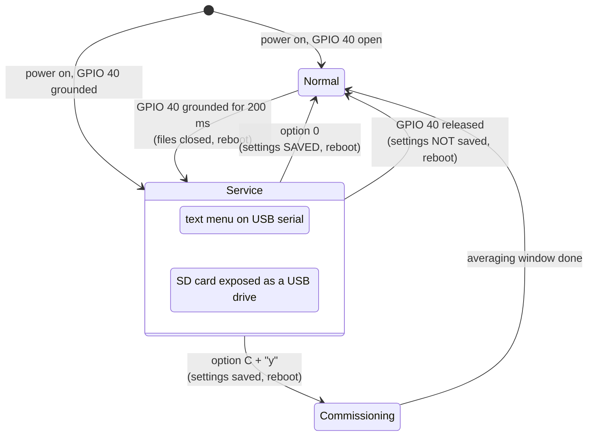

# Configuration menu (field service mode)

All field settings are changed from a text menu over USB. Nothing needs
reflashing. Settings are stored in the board's flash (NVS), so they survive
power loss and reflashing.

## Enter and leave



1. Connect USB-C to the laptop and open a serial terminal at 115200 baud.
2. **Ground GPIO 40** (jumper, switch or service-cable wire) to enter. You
   can do this at power-on or at any time while the station runs. The
   station closes its files, reboots, and shows the menu.
3. Use the menu. While you are in it, the SD card also appears on the
   laptop as a **USB drive**; see [Getting data off](data-retrieval.md).
4. **Select `0` to save and exit.** The station reboots into normal operation.

!!! danger "Unplugging the jumper does not save"
    Releasing GPIO 40 leaves the menu and reboots **without saving**. Any
    changes made in this session are lost. Always use `0) Save and exit`
    first, then remove the jumper.

!!! warning "Nothing is recorded while in the menu"
    In service mode the geophone and GNSS are not recorded, and no telemetry
    is sent. The SD card belongs to the laptop. Keep visits short, and note
    the gap in your site log.

!!! note "Disconnecting the USB drive"
    Eject the USB drive on the laptop before you leave the menu. Leaving
    the menu reboots the station and takes the drive away from the laptop.

## The menu

```text
=== Field service menu ===
1) Show current configuration
2) Set GNSS measurement interval (s)
3) Set GNSS fix timeout (s)
4) Set good-fix horizontal accuracy (m)
5) Set MQTT broker
6) Set NTRIP caster
7) Set upload endpoint
A) Set PPK minimum recording duration (s)
B) Set reference-position averaging window (s)
C) Start commissioning (establish reference position)
D) Set low-battery cutoff (V) - new bursts skipped below this
E) Set NTRIP on every Nth burst (1 = every burst)
F) Set MiniSEED network/station/location codes
G) Toggle MiniSEED Steim2 compression
0) Save and exit
>
```

Type one character and press Enter. Letters work in upper or lower case.
When a value is asked for, the current value is shown in brackets. **Press
Enter on an empty line to keep it.**

## Option reference

| Opt. | Setting | Default | What it does | Battery impact |
|---|---|---|---|---|
| `1` | — | — | Prints every setting, the SD free space, the commissioning state, and the **current external battery voltage**. | — |
| `2` | Measurement interval | 600 s | Time between the starts of two GNSS bursts. | Longer interval: less energy |
| `3` | Fix timeout | 120 s | How long to wait for a first fix, and then again for the target accuracy. | Bounds the worst-case burst |
| `4` | Good-fix accuracy | 0.050 m | Horizontal accuracy a fix must reach to count as `quality_ok`. Only such fixes are used for displacement and commissioning. | Tighter: longer bursts |
| `5` | MQTT broker | from `secrets.h` | Prompts in turn: host, port, client ID, username/token, password, topic. | — |
| `6` | NTRIP caster | from `secrets.h` | Prompts in turn: host, port, mountpoint, user, password. | — |
| `7` | Upload endpoint | from `secrets.h` | Prompts in turn: host, port, API key. An empty host disables the daily upload. | — |
| `A` | PPK minimum duration | 120 s | Minimum raw-observation recording after the first fix in each burst, for post-processing. The burst lasts at least this long. | Longer: more energy |
| `B` | Reference averaging window | 7200 s (2 h) | How long commissioning averages fixes. | — |
| `C` | Start commissioning | — | Asks `Proceed? [y/N]`. On `y`: saves, starts commissioning, reboots. See [Commissioning](commissioning.md). | Bursts run back-to-back until done |
| `D` | Low-battery cutoff | 11.8 V | Below this (external battery), new GNSS/modem bursts are skipped. They resume at cutoff + 0.2 V. The geophone keeps recording. | Protects the pack |
| `E` | NTRIP every Nth burst | 1 | With N > 1, only every Nth burst uses NTRIP and the modem (and with it MQTT and the upload). The others only record raw UBX for PPK. `0` is treated as 1. | Big saving: the modem is the costly part |
| `F` | MiniSEED codes | `XX` / `PERM1` / blank | SEED network, station and location written into every MiniSEED record. Codes are upper-cased and non-alphanumerics dropped. Enter `-` for a blank location. | — |
| `G` | MiniSEED Steim2 | on | Toggles between Steim2 (lossless, 2–4× smaller) and uncompressed int32. | — |
| `0` | — | — | **Saves** to flash and reboots into normal operation. | — |

!!! tip "Give every station its own station code"
    Before deploying more than one station, set a unique station code with
    `F`. Otherwise all your MiniSEED files will claim to be `XX.PERM1`.

!!! info "Changing SEED codes or encoding mid-day"
    Today's MiniSEED file keeps its name. Records written after the change
    carry the new codes or encoding. Tools such as ObsPy handle mixed
    records, but changing codes once, at deployment, is simplest.

## Choosing intervals: a quick guide

| Goal | Suggested settings |
|---|---|
| Default: displacement every 10 min, RTK each time | `2`=600, `E`=1 |
| Save battery, still RTK hourly | `2`=600, `E`=6 (PPK raw every 10 min, RTK + telemetry hourly) |
| Very low power | `2`=3600, `E`=1, consider raising `D` |
| Faster RTK convergence on a hard site | raise `3` (fix timeout), keep `4` at 0.05 m |

Without RTK, positions are recorded at autonomous quality. Raw UBX is
still logged, so you can post-process (PPK) later; see
[GNSS raw / PPK](../data/gnss-raw.md).
