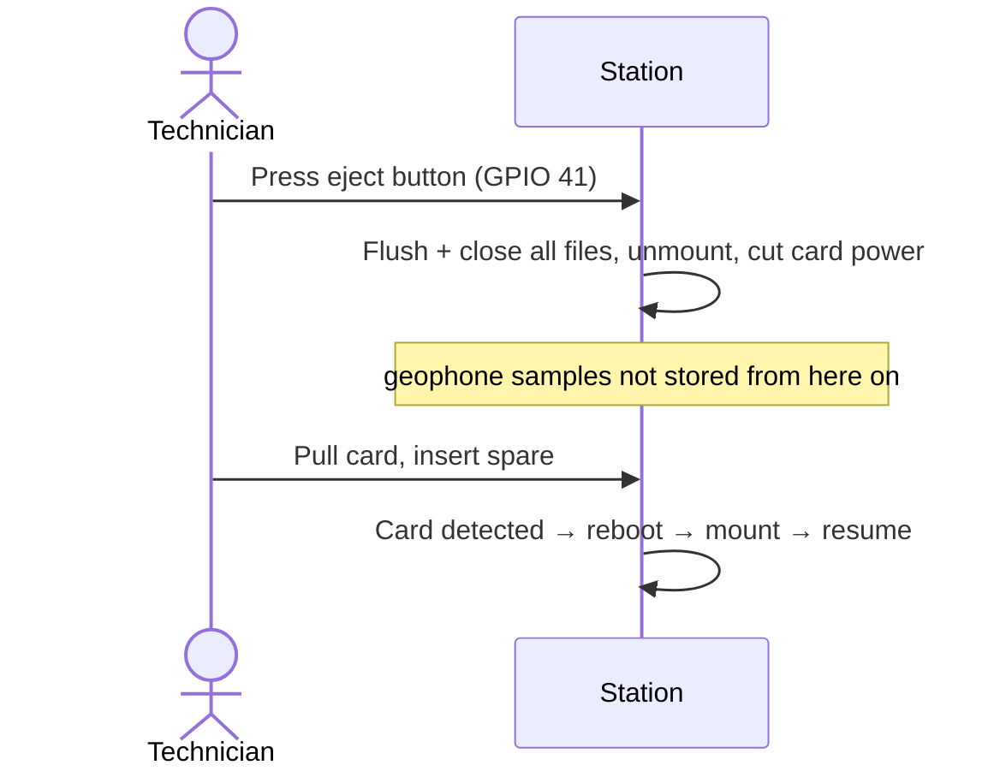

# Getting data off the station

The MiniSEED and raw GNSS files are **never transmitted**. They are too
large for LTE-M. They stay on the SD card until someone collects them.
There are two ways to collect them.

| | A. USB drive (service mode) | B. Eject and swap the card |
|---|---|---|
| Tools | Laptop + USB-C + service jumper | Eject button + spare card |
| Recording gap | Whole time in the menu | About a minute (reboot) |
| Best for | Spot checks, copying a few days | Full cards, long visits |

## A. Copy over USB (service mode)

1. Connect USB-C and ground GPIO 40. The station reboots into the
   [service menu](configuration.md).
2. The SD card appears on the laptop as a removable drive.
3. Copy the `data/` folder (see [SD card layout](../data/sd-layout.md)).
4. **Eject the drive on the laptop** (Safely Remove Hardware / Eject).
5. Select `0` in the menu to leave. The station reboots and resumes recording.

!!! warning "Don't delete files from the station's card unless you mean to"
    Deleting is possible over USB. The firmware recreates its folders at
    the next boot. Copy first, check the copies, then delete if you need the
    space.

## B. Eject and swap the card

1. Press the eject button once. The console prints
   `SD: eject button pressed - flushing and unmounting...`
2. Pull the card. Insert a spare formatted as **FAT32**. Cards larger than 32 GB usually
   ship as exFAT; reformat those to FAT32 and test them on the bench first.
3. The station detects the new card and reboots to mount it. Pressing the
   eject button again also reboots and remounts.

On the laptop, copy `data/` from the old card.

## What to copy

| Folder | Contents |
|---|---|
| `data/positions_YYYYMMDD.csv` | One row per burst. Also sent by MQTT and the daily upload. |
| `data/geophones/geophone_YYYYMMDD.mseed` | Continuous 3-channel seismic data |
| `data/gnss/*.ubx`, `*.rtcm` | Raw GNSS observations and corrections per burst, for PPK |

Dates and times in filenames are **UTC**.
