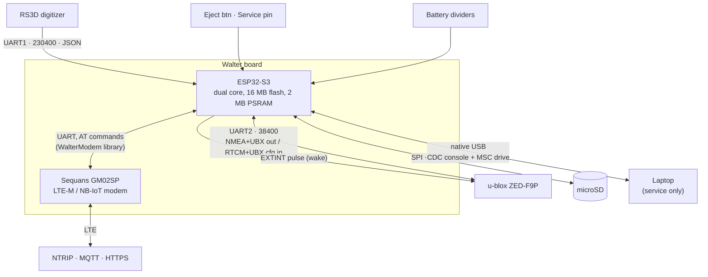
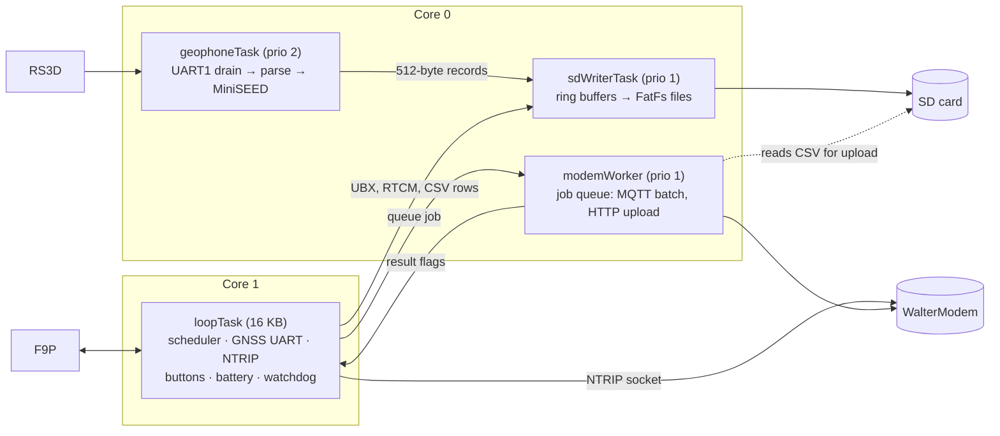
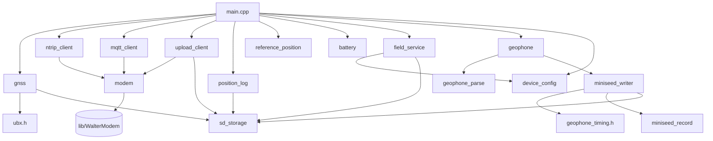
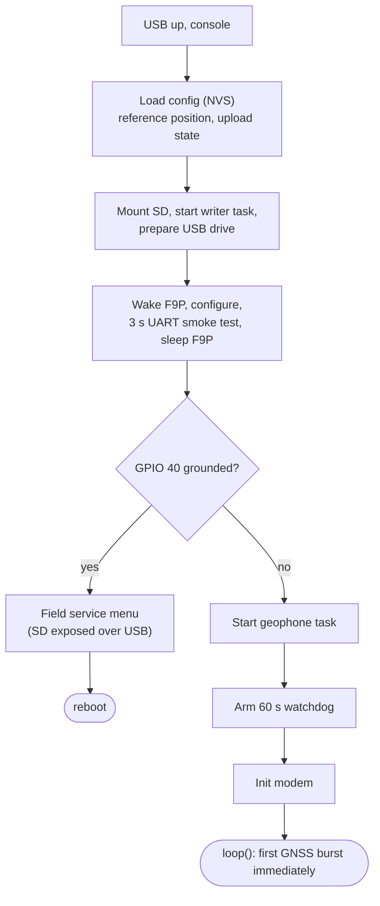

# Architecture

## Hardware

## Firmware tasks

The firmware runs four tasks of its own, plus the modem library's internal
ones. The split exists so that nothing slow can make the geophone lose
samples, and nothing blocking can trip the watchdog.

| Task | Stack / priority / core | Job | Source |
|---|---|---|---|
| `loopTask` | 16 KB, Arduino default, core 1 | Scheduler: GNSS bursts, NTRIP relay, battery, buttons, field-service trigger. Fed to the 60 s watchdog. | `src/main.cpp` |
| `geophoneTask` | 6 KB, prio 2, core 0 | Drains the digitizer UART, parses JSON packets, timestamps samples, builds MiniSEED records | `src/geophone.cpp`, `src/miniseed_writer.cpp` |
| `sdWriterTask` | 10 KB, prio 1, core 0 | Only task that writes files. Producers just `memcpy` into per-stream ring buffers. | `src/sd_storage.cpp` |
| `modemWorker` | 8 KB, prio 1, core 0 | Runs blocking AT sequences (MQTT connect/publish, HTTP POST) one at a time | `src/modem.cpp` |

### Rules that keep this safe

- **Producers never block on SD.** `sdStreamWrite()` copies into a ring
  buffer. If the card stalls, data is dropped and counted (`SDdrop` in
  `[STATUS]`) rather than freezing the producer.
- **One modem user at a time.** The NTRIP socket is driven from `loopTask`
  during a burst. MQTT and upload jobs run on `modemWorker` *after* NTRIP
  disconnects. A new burst waits up to 60 s for unfinished jobs before
  touching the modem.
- **The modem sleeps only when its jobs are done.** `loopTask` sets
  `modemSleepPending`, and calls `modemSleep()` once `modemJobsBusy()` is
  false.
- **Service mode never runs the geophone task.** The geophone task starts
  only after the field-service check, so it can't write while the card is
  exposed over USB.

## Module map

File-by-file details: [Code map](../develop/code-map.md).

## Boot sequence

