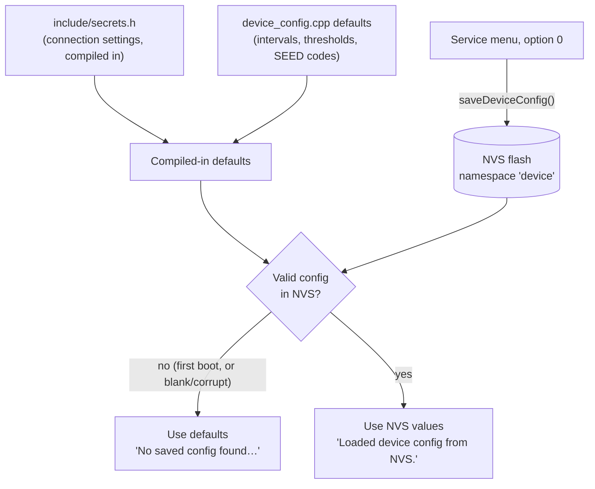

# Configuration model

Settings come from three places. Knowing which one wins avoids the classic
surprise: "I reflashed with a new `secrets.h` and nothing changed."

- The **compiled-in defaults** are used only when NVS holds no valid
  configuration. "Valid" means no empty host, no zero port, and a non-zero
  interval and timeout.
- **Saving from the menu** writes the whole configuration to NVS. From then
  on, NVS wins over anything compiled in.
- **NVS survives reflashing** (`pio run -t upload` doesn't erase it). To go
  back to compiled-in defaults, erase flash with `pio run -e walter -t erase`,
  then upload again. This also erases the reference position and upload
  state.

## What is stored where

| NVS namespace | Keys | Written by |
|---|---|---|
| `device` | All menu settings (see [menu reference](../field/configuration.md#option-reference)) | Menu `0` and `C` |
| `refpos` | `locked`, `ref_lat`, `ref_lon`, `ref_alt`, `commissioning` + running mean | Commissioning |
| `upload` | `next_date` (oldest finished UTC day not yet uploaded) | Daily upload |

## Settings vs constants

| Kind | Examples | How to change |
|---|---|---|
| Connection seeds | NTRIP, MQTT, upload host/credentials | `secrets.h` (first boot) or menu `5`, `6`, `7` |
| Field settings | Interval, timeouts, accuracy, PPK floor, cutoff, every-N, SEED codes, Steim2 | Menu |
| Engineering constants | GGA interval, stall timeout, watchdog, hysteresis, 1 GB floor, chunk size, pins, divider ratios | Edit source and reflash; see [Code map](../develop/code-map.md) |
