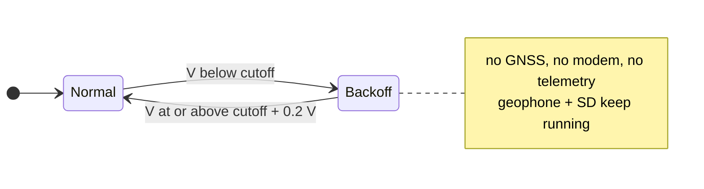

# Power management

The geophone streams continuously at 230400 baud and can't be paused, so
the ESP32 never deep-sleeps. Power is saved by sleeping the two big
consumers between bursts: the **GNSS receiver** and the **modem**.

## What is on, when

```mermaid
gantt
  title One measurement interval (default 600 s, NTRIP every burst)
  dateFormat  s
  axisFormat  %M:%S
  section ESP32 + geophone + SD
  always on                     :active, 0, 600s
  section ZED-F9P
  first fix (≤120 s)            :crit, 0, 40s
  RTK + PPK recording (≥120 s)  :crit, 40, 120s
  backup mode (EXTINT wake)     :160, 440s
  section Modem
  NO_RF                         :0, 40s
  registered · NTRIP            :crit, 40, 120s
  MQTT · upload jobs            :crit, 160, 15s
  NO_RF                         :175, 425s
```

The durations are typical examples. The real ones depend on time to first
fix, RTK convergence, and the settings in the [menu](../field/configuration.md).

| Component | Between bursts | During a burst | Mechanism |
|---|---|---|---|
| ESP32-S3 | On (`loop()` yields every 10 ms) | On | No deep sleep: the geophone must be read |
| RS3D geophone | On | On | Not controllable |
| SD card | On (rail held enabled) | On | Written continuously |
| ZED-F9P | **Backup mode** (`UBX-RXM-PMREQ`) | On | Woken by a pulse on EXTINT. Only EXTINT is armed as a wake source: UART noise used to keep it awake. |
| GM02SP modem | **`NO_RF`** | `FULL` (on NTRIP bursts only) | `modemSleep()` once the MQTT/upload jobs are done |

## Ways to lower consumption

| Setting | Effect |
|---|---|
| Longer interval (`2`) | Fewer bursts |
| NTRIP every Nth burst (`E`) | Modem off on most bursts. The F9P still records raw data for PPK. |
| Shorter PPK minimum (`A`) | Shorter F9P on-time per burst, but weaker post-processing |
| Looser good-fix accuracy (`4`) | RTK bursts end sooner |

## Low-battery backoff

The external battery is read every 30 s (16 averaged ADC reads). Below the
cutoff, new bursts are skipped. Geophone and SD logging continue, since
they draw comparatively little.

The 0.2 V hysteresis stops a pack that sags under burst load from flipping
between the two states. The default cutoff (11.8 V) assumes a 12 V
lead-acid pack. Set it with menu `D` for other chemistries.

!!! note "A burst already running is not cut short"
    The check gates the *start* of a burst. A burst that has started
    finishes normally.

## Time while asleep

The F9P's UTC fields freeze while it is in backup mode. Anything that
needs current time between bursts (file rotation, row timestamps,
MiniSEED times) extrapolates from the last fix using the ESP32's
`millis()` clock. See [Timing](timing.md).
