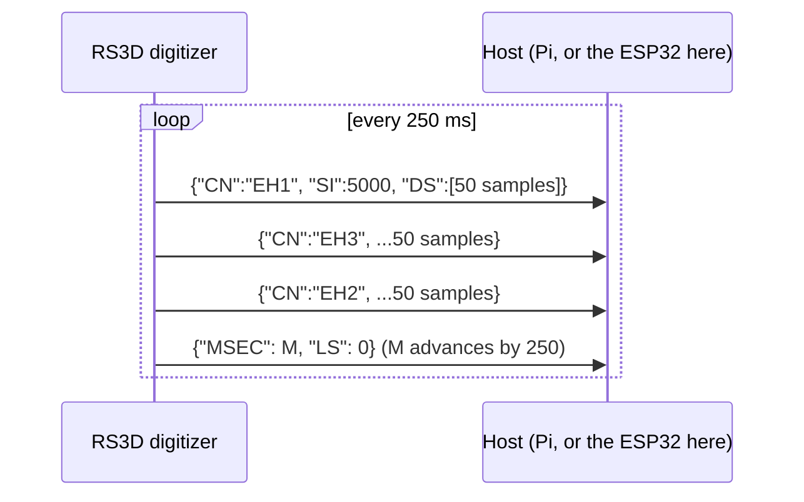

# How the Raspberry Shake works

!!! abstract "Where this fits"
    This is the background research that made the project possible: how
    the RS3D digitizer talks to its host, reverse-engineered. For how *this
    firmware* uses it, see [Architecture](architecture.md) and
    [Timing](timing.md). Section 4 below weighs timing options. The project
    went with GNSS time from the ZED-F9P it already carries for positioning.

This documents what we found while building an ESP32-based replacement for
the Raspberry Pi in a Raspberry Shake RS3D. Most of it is not published
anywhere by Raspberry Shake/OSOP; it was reverse-engineered directly from a
physical unit and from an SD card image of the stock software, over the
course of this project. Where something comes from the official spec
sheets, it's noted as such; everything else was measured or read out of the
device's own binaries and config files.

## 1. Hardware architecture

A Raspberry Shake is three things in one enclosure:

1. **Sensor** — a geophone (in our unit: 3-axis, Racotech-type 4.5 Hz
   vertical geophones extended electronically to sub-1 Hz response).
2. **Digitizer board** — a 24-bit sigma-delta ADC front end plus its own
   microcontroller. It reads the analog geophone signal, digitizes all
   three channels, and streams the result out over a serial link. This
   board is a HAT that plugs onto a Raspberry Pi's 40-pin GPIO header.
3. **Raspberry Pi** — the host computer. It does not talk to the ADC
   directly; it just reads a UART stream from the digitizer board and runs
   all the acquisition/archival/networking software.

### GPIO header pinout (from the official spec sheet)

| Pins | Function |
|---|---|
| 2, 4 | 5V power |
| 6, 9, 14, 20, 25 | Ground |
| 8, 10 | UART Tx/Rx (Pi TXD / Pi RXD) — the digitizer link |
| 15 | Reset |
| 17 | 3.3V |
| all others (1-26 remainder, 27-40) | free for user projects |

Pin 8 is the Pi's TXD (Pi → digitizer), pin 10 is the Pi's RXD (digitizer →
Pi, i.e. the channel that carries sensor data). Both sides are 3.3 V logic.

### The digitizer-to-host link

This is the part that isn't documented anywhere public. We determined it by
imaging the Shake's SD card, mounting its root filesystem, and
disassembling the acquisition binary (`odf_SL_plugin`, see §3). The link
is:

- **230400 baud, 8N1**, plain UART, no flow control.
  Confirmed by disassembling `open_SPort()`: it calls
  `set_interface_attribs(fd, 0x1003, 0)`, and `0x1003` is the Linux
  `termios` `speed_t` constant for `B230400` (octal `0010003`). The `0`
  third argument selects no-parity 8-bit mode.
- The Pi side device path is `/dev/ttyS0` (read from
  `/opt/settings/sys/ODFSPNAME.txt` on the stock image).
- `config.txt` sets `enable_uart=1` and `force_turbo=1` — the latter pins
  the Pi's core clock so the UART baud rate doesn't drift, which matters
  because `/dev/ttyS0` on Pi models with Bluetooth is the "mini UART",
  whose clock is normally tied to the dynamically-scaled VPU core clock.

## 2. The wire protocol

The digitizer streams newline-free, back-to-back JSON objects. There are
two object types.



**Channel data**, sent for each component in turn:

```json
{"MA": "RS3D-11-4.19", "DF": "1.0", "CN": "EH1", "TS": 0, "TSM": 0,
 "TQ": 45, "SI": 5000, "DS": ["3F62", "4051", ..., "FFFFA804"]}
```

| Field | Meaning |
|---|---|
| `MA`  | Model/firmware string (`RS3D-11-4.19` for this unit) |
| `DF`  | Data format version (`"1.0"`) |
| `CN`  | Channel name — cycles `EH1` → `EH3` → `EH2` |
| `TS`  | Timestamp, seconds |
| `TSM` | Timestamp, sub-second (ms) |
| `TQ`  | Timing quality |
| `SI`  | Sample interval, **microseconds** |
| `DS`  | Array of samples for this burst |

**Cycle marker**, sent once after each 3-channel round:

```json
{"MSEC": 64500, "LS": 0}
```

`MSEC` is a running millisecond counter that increments by exactly 250 on
every marker — this is the "4 packets/second (250 ms/packet)" EEW cadence
the spec sheet mentions. `LS` is 0 in all our captures; most likely a
lock-status/leap-second flag.

### Sample encoding

Each `DS` entry is a **signed 32-bit integer, hex-encoded with no
zero-padding**. This is just what you get from formatting a signed int
with `%X`/`%x`: small positive values print as few digits (`"3F62"` =
16226), while negative values always print all 8 digits, because two's
complement sign-extension fills the upper nibbles with `F` (`"FFFFA804"` =
-22524). Parse with `strtoul(token, NULL, 16)` and reinterpret the result
as `int32_t` — do **not** use a signed parser, or negative values will
saturate incorrectly.

### Measured data rate

We measured this directly rather than trusting the spec sheet's "100 sps"
figure, because the numbers didn't initially reconcile:

- Every `DS` array contains **exactly 50 samples** (zero variance across
  hundreds of packets).
- `MSEC` advances by exactly 250 ms every cycle.
- 50 samples / 0.25 s = **200 samples/second per channel**, matching
  `"SI": 5000` (5000 µs = 5 ms = 200 Hz) independently.

This 200 sps is the **raw digitizer output**, not the archived rate. The
Pi-side config (`ODF_dataProc.conf`, see §3) sets the target output rate
(`"spsv": 100`) with `"decimation": true` — the acquisition software
decimates 200 sps down to the published 100 sps before it's archived to
miniSEED. If you're reading the raw UART link directly (as our ESP32
does), you get the undecimated 200 Hz feed.

### Converting counts to velocity

Raw `DS` values are ADC counts, not physical units. Divide by the
digitizer's sensitivity (counts per m/s) to get velocity. Per the official
spec sheet:

| Hardware rev | Sensitivity (counts / (m/s)) |
|---|---|
| V7+ | 3.9965 × 10⁸ |
| V6  | 3.81 × 10⁸ |
| V5/V4 | 4.69 × 10⁸ |

The `"11"` in the `MA` field (`"RS3D-11-4.19"`) is this unit's actual board
revision — **V11** — which falls under the spec sheet's "V7+" bracket (its
sensitivity table tops out at V7+ as a catch-all for that revision and
newer). Use **3.9965 × 10⁸ counts/(m/s)** for this unit. The firmware
itself stores raw counts and applies no sensitivity; see
[MiniSEED](../data/miniseed.md#converting-counts-to-ground-velocity).

## 3. Software stack (Raspberry Pi side)

The Pi runs a Debian-based image with most services distributed as Docker
containers. Key pieces found in the SD card image:

- **`odf_SL_plugin`** (`/opt/bin/odf_SL_plugin`, symlinked from
  `/opt/seiscomp/bin/` and `/opt/seiscomp/acquisition/bin/`) — an ARM ELF
  binary built on **Gempa's CAPS** framework (the same vendor/toolkit
  behind SeisComP's professional acquisition tools; symbol table shows
  `Gempa::CAPS::Steim1Encoder`/`Steim2Encoder`, `MSEEDDataRecord`, etc.).
  This is the process that owns `/dev/ttyS0`, reads the raw JSON stream
  described in §2 (function `ODFSerialRead`), and republishes it as a
  SeedLink plugin feed, Steim-compressed into miniSEED.
- **SeisComP3** — the seismological acquisition/processing suite that
  hosts the ODF plugin. Runs a native SeedLink server (sourced from
  GEOFON) for standard seismology tooling (ObsPy, SeisComP, Earthworm,
  etc. can all pull data from it).
- **Configuration**: `/opt/settings/seiscomp/ODF_dataProc.conf` (a symlink
  to a model/output-specific variant, e.g. `ODF_dataProc.conf.3D.SC-UDP`
  for a 3-channel unit feeding both SeisComP and UDP). Structure:

  ```json
  {
    "source": "INSTRUMENT",
    "dests": [{"destination": "SEISCOMP", ...}],
    "logging": {"directory": "/opt/log", "enabled": true},
    "SRCinstrument": {
      "port": "SYSPORTFILE:/opt/settings/sys/ODFSPNAME.txt",
      "net": "AM",
      "stn": "STNNAMEFILE:/opt/settings/sys/STN.txt",
      "spsv": 100,
      "decimation": true,
      "gpslock-statusfile": "",
      "gpsFile": ""
    }
  }
  ```

  `net: "AM"` is Raspberry Shake's amateur/citizen-seismology network code.
  The `gpslock-statusfile`/`gpsFile` fields show the software has a defined
  path for GPS integration — see §4.
- **Data storage**: continuous miniSEED under `/opt/data/archive/<year>/`,
  helicorder GIFs under `/opt/data/gifs/`.
- **Web interface**: nginx + a Flask-based backend, served at `rs.local`,
  used for configuration (including the UDP "DATACAST" feature — see
  below) and status pages.
- **Real-time data-out options** (no GPIO wiring needed, unlike this
  project's UART tap):
  - **UDP casting**, port 8888, minimal JSON-ish packets, configurable
    from the web UI (Settings → DATACAST) or
    `/opt/settings/user/UDP-data-streams.conf`. This is what the `rsudp`
    tool consumes.
  - **SeedLink** / **FDSN web services**, for standard seismology clients.
- **Other services visible in `/opt/log/`**: `gpsd-mgr` (GPS daemon
  manager — confirms GPS is handled by the standard Linux `gpsd`, as an
  optional external peripheral, not built into the digitizer board),
  `seedlink`, `myshake` (integration with the MyShake/ShakeAlert citizen
  seismology network), `purge-super` (data retention cleanup),
  `postboot`, `upgrade`.

## 4. Does the digitizer need GPS or a clock input?

Short answer: **the digitizer itself has no absolute time source.** It
free-runs on its own local oscillator, which gives excellent *relative*
timing (our 200 Hz / 250 ms cadence measurements were rock-solid with zero
observed jitter over thousands of packets) but no idea what wall-clock
time it is, unless something tells it.

Evidence, from our own test rig (digitizer board wired straight to an
ESP32, no Raspberry Pi at all in the loop): every packet we captured had
`"TS": 0, "TSM": 0` — the timestamp fields never left their default/unset
state. `"TQ": 45` was constant too, which looks like a fixed "no
reference" quality value rather than a real lock indicator.

On a stock Raspberry Shake, absolute time comes from the **Pi**, via one
of two paths (both referenced in the config in §3):

1. **NTP over the network** (Ethernet/WiFi) — the default. Per the spec
   sheet, this holds ±10 ms accuracy at 100 sps once synced.
2. **GPS** — optional, handled by `gpsd` on the Pi, feeding an external
   GPS receiver's fix (and ideally its PPS signal) into the acquisition
   chain via the `gpsFile`/`gpslock-statusfile` config fields. This is the
   more precise and network-independent option, and is what you'd want
   for genuine earthquake-early-warning-grade timing.

**Implication for the ESP32 replacement**: since there's no Pi/NTP/`gpsd`
in this architecture anymore, *something* has to supply absolute time if
the data needs real UTC timestamps (which it will, for anything beyond a
local demo — event correlation, EEW, or just making sense of the data
later). The digitizer board will not do this on its own. Two practical
options for the ESP32:

- **NTP over WiFi/4G**, fetched whenever the modem wakes up to transmit.
  No extra hardware, simplest to implement, accuracy is fine for general
  monitoring but tied to network availability — a concern given the
  duty-cycled 4G/battery design already discussed for this project.
- **A dedicated GPS module** (e.g. NEO-6M/NEO-M8N) on a separate ESP32
  UART, disciplining an onboard clock via its PPS output. More hardware
  and cost, but gives accurate absolute time independent of cellular
  coverage — worth it if the station needs to keep good time through
  network outages, or if sub-sample timing precision matters for
  event-trigger/EEW logic.

Given the remote, battery/4G-constrained, EEW-adjacent nature of this
deployment, GPS is the more robust choice; NTP-over-4G is the simpler
fallback if timing requirements are relaxed.

!!! success "What the firmware does"
    It uses GNSS time from the ZED-F9P, which the station needs for
    positioning anyway. No separate GPS module and no PPS are used. The
    digitizer's `MSEC` marker is mapped onto GNSS UTC; see
    [Timing](timing.md).

## 5. How this was reverse-engineered (methodology notes)

For reference, since none of this is published:

1. Empirically swept candidate baud rates on the UART while hex-dumping
   what came back — inconclusive/misleading on its own (see below).
2. Imaged the Shake's SD card (FTK Imager, raw/dd split image).
3. Mounted the ext4 root partition read-only inside a privileged Docker
   container (`losetup -o <partition-offset> --show`, then
   `mount -o ro <loopdev> /mnt`) — this sidestepped needing `sudo` in WSL
   or fighting a flaky USB SD-card-reader's WSL passthrough.
4. Found the acquisition binary (`odf_SL_plugin`) and its config
   (`ODF_dataProc.conf`) under `/opt`.
5. Disassembled the ARM binary with `arm-linux-gnueabihf-objdump -d`
   (needed cross-binutils; the host's native amd64 `objdump` can't
   disassemble ARM code) and located the exact `set_interface_attribs`
   call and its baud-rate literal.
6. Re-captured the UART at the *correct* rate and confirmed the JSON
   structure by extracting long runs of printable ASCII from the raw
   capture.
7. Verified sample rate and packet cadence by direct counting (parsing
   real captures for `DS` array lengths and `MSEC` deltas), rather than
   trusting the spec sheet's archived-rate figure.

The lesson embedded in step 1: baud-mismatch garbage and genuine
line-noise garbage can look superficially similar (lots of near-zero/NUL
bytes with occasional plausible ASCII by chance); don't trust pattern-eyeballing
over a confirmed ground truth when one is available.
