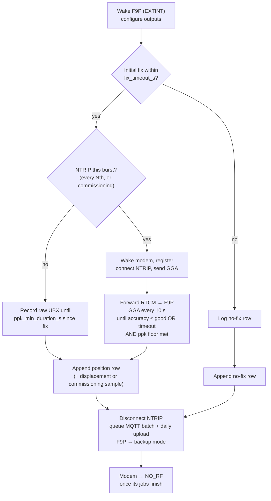
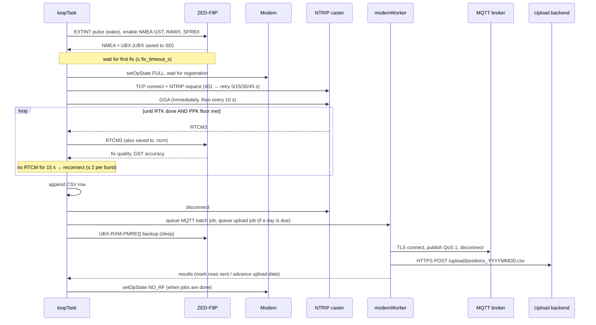

# GNSS fix cycle

`loop()` runs forever. It polls the GNSS UART, the buttons and the
field-service pin, checks the battery every 30 s, and starts a **burst**
when one is due:

- **First burst:** immediately after boot.
- **Commissioning:** back-to-back.
- **Otherwise:** `measurement_interval_s` (default 600 s) after the start
  of the previous burst.

No burst starts while the battery is below the cutoff; see
[Power](power.md#low-battery-backoff).

## One burst, step by step

If the burst is not an NTRIP burst and there is no initial fix, it ends at
once. The modem is not woken.

## Sequence with the outside world

## Timers and limits

| Constant | Value | Where | Purpose |
|---|---|---|---|
| `measurement_interval_s` | 600 s (menu `2`) | NVS | Burst period, start to start |
| `fix_timeout_s` | 120 s (menu `3`) | NVS | Applied twice: wait for first fix, then wait for good accuracy |
| `good_accuracy_m` | 0.05 m (menu `4`) | NVS | Ends RTK convergence; sets `quality_ok` |
| `ppk_min_duration_s` | 120 s (menu `A`) | NVS | Raw-recording floor after first fix |
| `ntrip_every_n_bursts` | 1 (menu `E`) | NVS | NTRIP/modem on every Nth burst |
| `GGA_RESEND_INTERVAL_MS` | 10 s | `main.cpp` | Network RTK/VRS mounts need the rover position |
| `GGA_FAILURE_RETRY_MS` | 1.5 s | `main.cpp` | Faster retry after a failed GGA send |
| `NTRIP_STALL_TIMEOUT_MS` | 15 s | `main.cpp` | No RTCM: reconnect |
| `NTRIP_MAX_RECONNECTS_PER_BURST` | 2 | `main.cpp` | |
| NTRIP connect attempts | 5; 401 waits 5/15/30/45 s, others 10 s | `ntrip_client.cpp` | Caster-side sessions take time to clear |
| `MODEM_JOB_WAIT_MS` | 60 s | `main.cpp` | Wait for previous MQTT/upload jobs before NTRIP |
| `GNSS_CONFIG_REFRESH_INTERVAL_MS` | 5 s | `main.cpp` | Re-send F9P output config (GST was seen to stop) |
| `UPLOAD_MAX_BACKLOG_DAYS` | 14 | `main.cpp` | Upload catch-up limit |

### Why wait for a fix before NTRIP?

Network-RTK (VRS) casters build the correction stream around the position
in the first GGA they receive. Connecting before the receiver has any fix
would waste the session on an empty GGA. The modem has nothing else to do
during that wait.

### Why at least `ppk_min_duration_s`?

RTK can converge in about 20 s. Stopping then would leave too little raw
data for reliable post-processing. The burst runs until **both** the RTK
side is done and the PPK floor is met.

## Telemetry and the daily upload

Both run **at the end of a burst**, on the modem session NTRIP already
opened. They add no extra wake-ups and are battery-gated like any burst:

- **MQTT:** all unsent rows from today's CSV, as one message; see
  [MQTT](../data/mqtt.md).
- **Upload:** the oldest finished UTC day not yet uploaded, one per burst;
  see [Upload API](../data/upload-api.md). The "next day to upload" is
  kept in NVS (namespace `upload`, key `next_date`).
