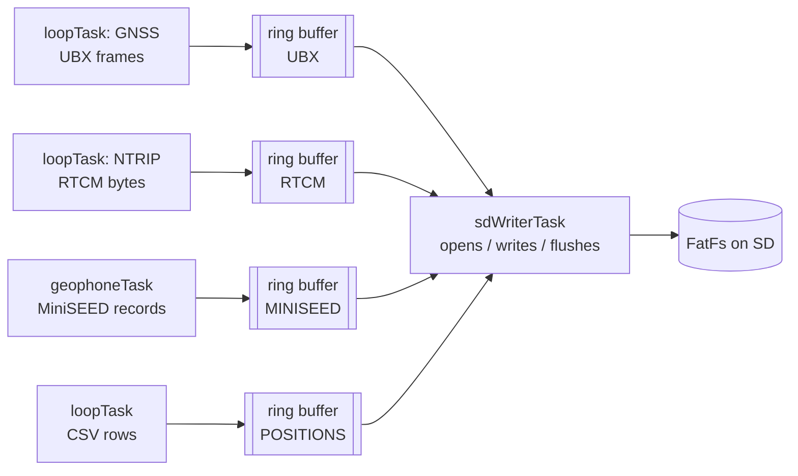
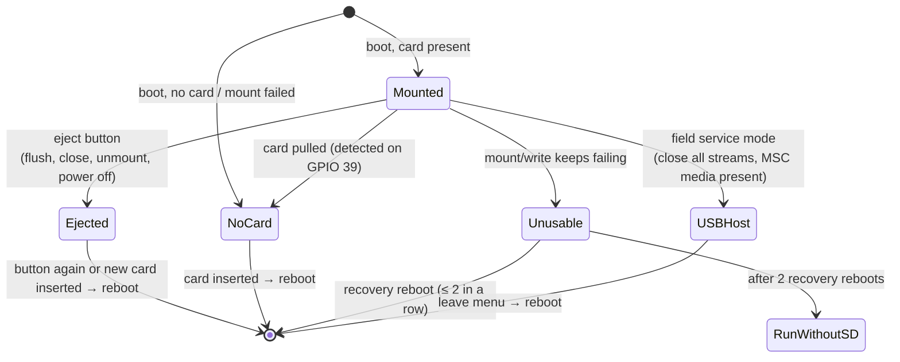

# Storage

## SD over SPI

The card runs in **SPI mode at 4 MHz**, not native SDMMC. SDMMC produced
repeated command timeouts on the reference board's wiring. SPI's looser
timing tolerates it, and the station's sustained write rate (a few kB/s)
is far below what even slow SPI can carry. The card's 3.3 V rail is
switched by GPIO 0 (active LOW) and held on continuously.

## One writer, many producers

- There are four fixed streams: UBX, RTCM, MINISEED and POSITIONS. Each
  has a ring buffer.
- Producers call `sdStreamWrite()`, which is a bounded `memcpy`. If a
  buffer is full, the bytes are **dropped and counted** (`SDdrop` in
  `[STATUS]`). A wedged card can block only the writer task, never data
  capture or the watchdog-fed main loop.
- Opening, rotating and closing files happen on the writer task too
  (`sdStreamOpen()`, `sdStreamClose()`).
- **Flush policy:** every 5 s for all streams; immediately after each CSV
  row (`sdStreamFlush()`).
- The daily upload reads the CSV directly from the modem worker. It
  registers as a reader (`sdReaderBegin()`/`End()`) so an eject waits for it
  or aborts it cleanly.

## Who owns the card

The card can be owned by the firmware (FatFs) **or** by a USB host (raw
sectors), never both. Two writers would corrupt the file system.

- **USB mass storage** (composite CDC + MSC, `ARDUINO_USB_MODE=0`): the MSC
  interface is always in the USB descriptor, because interfaces can't be
  added after enumeration. It reports "no media" outside service mode.
  `sdStorageMscEnable()` closes every FatFs stream before exposing the card.
- **Before every self-triggered reboot** (menu, eject, card swap, SD
  recovery), `sdStorageCloseAllForReboot()` closes all files, waiting at
  most 1 s.
- **Card-detect** is polled with a debounce. HIGH means present.

## Free space

`sdStorageFreeMb()` is refreshed every 60 s. Below 1 GB,
`sdStorageLowSpace()` is true, and the MiniSEED writer keeps timing samples
but stops writing them. See [SD card layout](../data/sd-layout.md#low-space).
