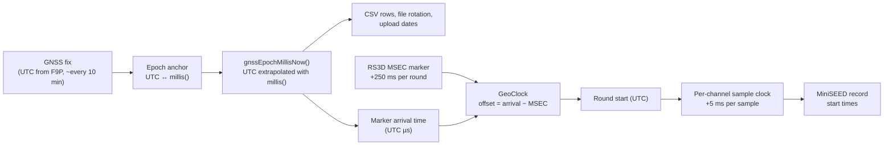

# Timing

The station has no RTC and no PPS input. Absolute time comes from GNSS
fixes. Seismic sample times come from the digitizer's own steady clock,
anchored to that GNSS time.

## The time chain



### 1. GNSS → system time

At each fix, the firmware records the UTC from the F9P together with the
ESP32's `millis()`. Between fixes, including the whole time the F9P sleeps,
`gnssEpochMillisNow()` returns:

**anchor UTC + (millis() − anchor millis)**

`gnssCivilNow()` gives the same instant as a calendar date and time.
Everything that needs "now" uses these two functions, not the GNSS
receiver's own time fields, which freeze while it sleeps.

!!! danger "No seismic data until the first GNSS fix after boot"
    Until the first fix after a boot, there is no anchor and so no UTC.
    The geophone task **drops** every sample until then, because it can't
    timestamp them. Uploads also wait. After a power cut or reboot, the
    MiniSEED gap therefore lasts until the first fix, normally under two
    minutes. If the antenna has no sky view (snow, ice), **no seismic data
    is recorded** until it gets one.

### 2. Digitizer clock → UTC (`GeoClock`)

The digitizer sends a cycle marker `{"MSEC": M}` after every three-channel
round. M increases by exactly 250 each round. The round that follows
marker M covers digitizer time [M, M + 250) ms.

For each marker, the firmware computes:

```text
measured offset = (UTC arrival time of marker) − M
```

- **First marker, or a jump of more than 50 ms:** the offset is
  **hard-reset**, and `Geophone: clock (re)anchored at MSEC=…` is logged.
  This should be rare: a GNSS re-anchor or a lost marker.
- **Otherwise:** the offset moves 1/64 of the way toward the new
  measurement. This smooths out UART and poll jitter and follows slow
  drift between the digitizer and ESP32 clocks.
- The 32-bit MSEC counter is unwrapped to 64 bits, so wraparound is
  harmless.

All three channels share the one mapping, so they stay aligned with each
other.

### 3. Per-channel continuity

Each channel keeps its own "next sample time", which advances by exactly
one sample interval (5 ms at 200 Hz) per sample. It is snapped to the
round's start time only if the two disagree by more than **20 ms**
(4 samples). That means a lost packet or accumulated drift. The result:

- MiniSEED records are **contiguous**, with no artificial gaps or overlaps
  from processing jitter.
- A resync shows up as a small time jump between two records, and is
  logged as `MiniSEED: EHx time re-synced by N us`.

The logic is header-only, in
[`include/geophone_timing.h`](https://github.com/LouisPauchet/open-permafrost-monitor/blob/main/include/geophone_timing.h),
and unit-tested on the PC (`pio test -e native`).

## Error budget

| Source | Effect | Size |
|---|---|---|
| Marker latency (UART + digitizer buffering) | Constant offset of all samples. **Not calibrated out.** | Unknown, probably milliseconds to tens of ms |
| `millis()` drift between GNSS fixes | Slowly growing error, reset at each fix | ESP32 crystal: tens of ppm, so tens of ms over 10 min |
| NMEA arrival latency when anchoring | Small constant offset | Milliseconds |
| Jitter | Smoothed by the 1/64 filter | Sub-ms after settling |

!!! warning "Use for monitoring, not precise absolute timing"
    Relative timing within the station (sample spacing, inter-channel
    alignment) is excellent. Absolute UTC is good to roughly
    **tens of milliseconds**, without a calibrated latency correction.
    That is fine for event detection and correlation at these scales, but
    not for sub-millisecond work.
