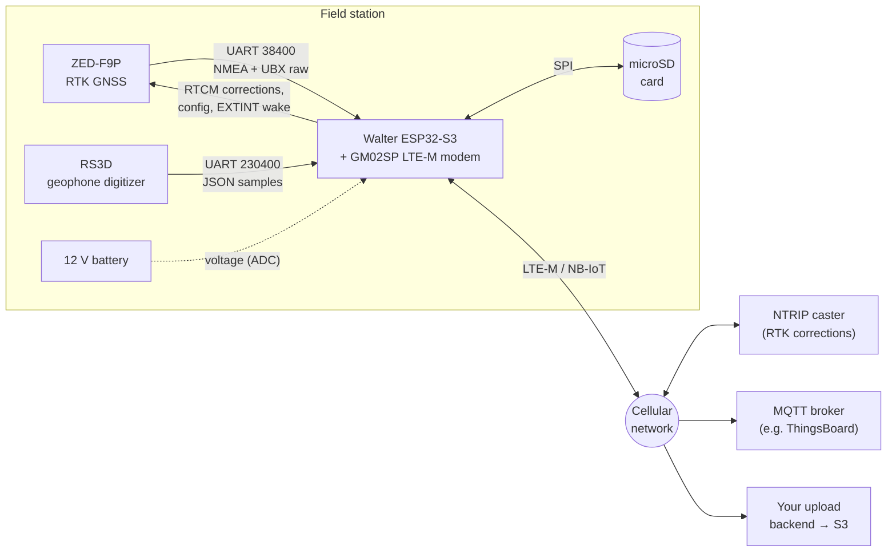

# Open Permafrost Monitor

An unattended field station that measures **ground movement** and **ground
vibration** at remote permafrost sites. It runs on battery, talks over a
cellular (LTE-M/NB-IoT) link, and needs no WiFi or router.

- **Ground movement:** a u-blox ZED-F9P RTK GNSS receiver wakes on a
  schedule, typically every 10 minutes. It gets centimetre-level fixes using
  NTRIP corrections, and reports how far the antenna has moved from a fixed
  reference point.
- **Ground vibration:** a Raspberry Shake RS3D geophone records three
  channels continuously at 200 samples/s to MiniSEED on the SD card.
- **Data out:** positions go out as MQTT telemetry after every measurement.
  The day's positions CSV is uploaded once a day. Everything, including the
  seismic data and raw GNSS observations, stays on the SD card for
  collection.



## Which page do I need?

| I want to… | Go to |
|---|---|
| Build a new station: parts, wiring, flashing | [Build a station](build/index.md) |
| Configure, deploy, service, or get data off a station | [Field use](field/index.md) |
| Use the data: MiniSEED, positions CSV, MQTT, raw GNSS | [Data](data/index.md) |
| Understand how the firmware works, with diagrams | [How it works](how-it-works/index.md) |
| Change the firmware, run the tests | [Develop](develop/index.md) |

## Five-minute quick start

For readers who already have PlatformIO and a wired station. Everyone else
should start at [Build a station](build/index.md).

```sh
git clone https://github.com/LouisPauchet/open-permafrost-monitor.git
cd open-permafrost-monitor
cp include/secrets.h.example include/secrets.h   # then edit it
pio run -e walter -t upload && pio device monitor -e walter
```

## Status and licence

This is research hardware built in the ARCHAIC project at SINTEF. It runs on
real hardware but is still evolving. Where the documentation and the code
disagree, the code is right; please [report it](develop/contributing.md).
The project is licensed under the
[EUPL v1.2](https://github.com/LouisPauchet/open-permafrost-monitor/blob/main/LICENCE).
